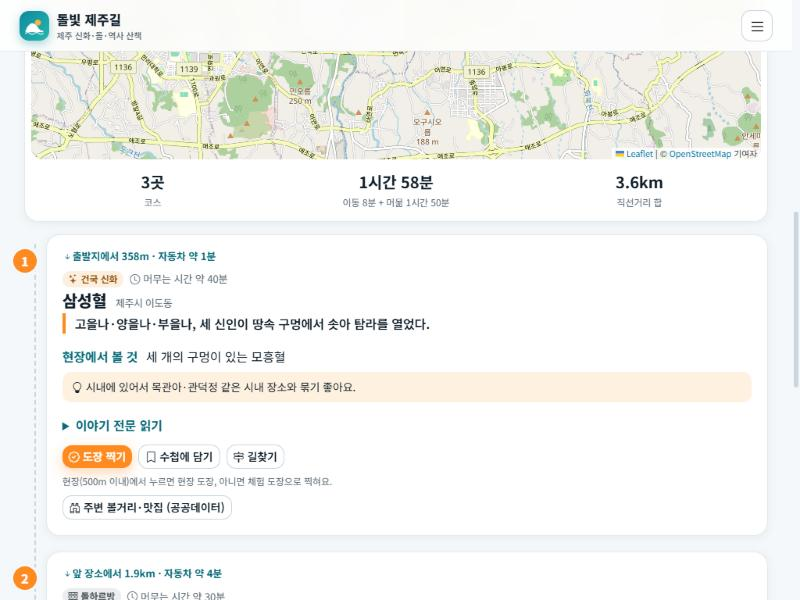
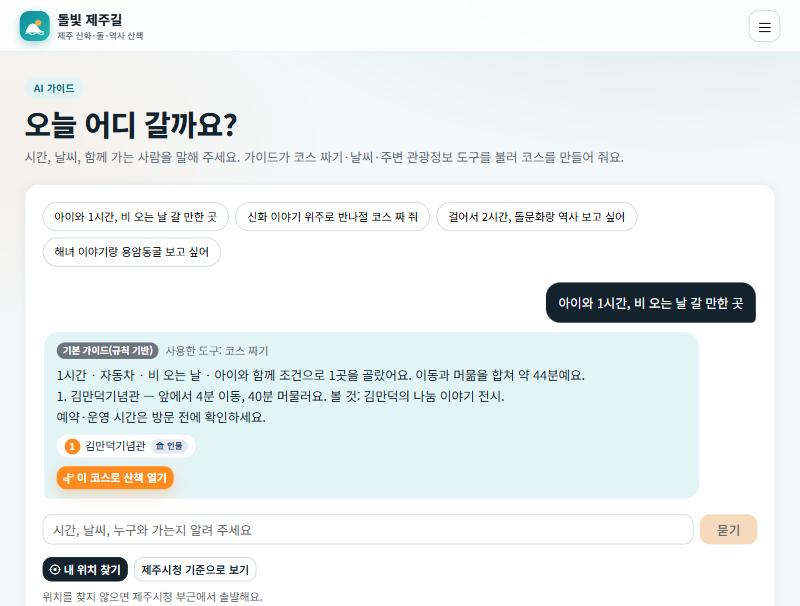
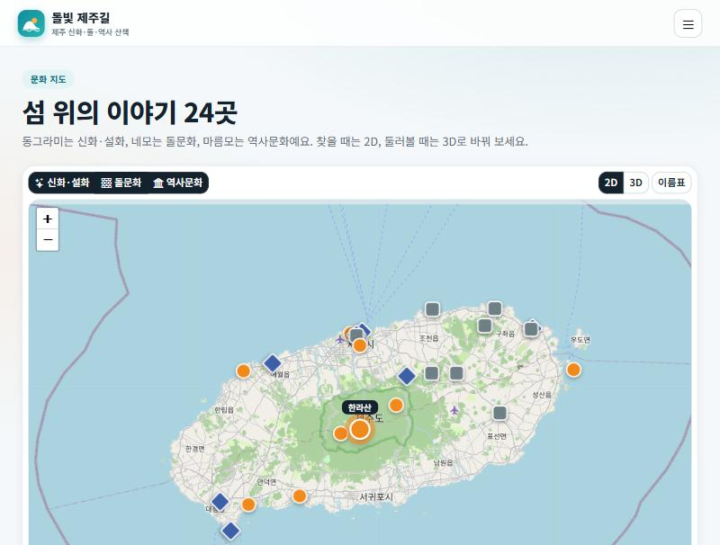
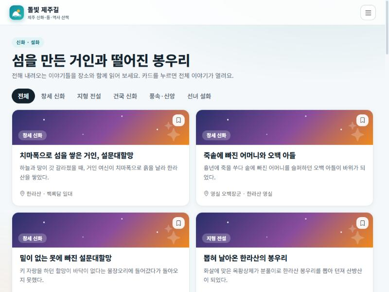

<div align="center">

# 🌋 돌빛 제주길

### 돌이 말하고, 바람이 전하는 섬 — 오늘 걸을 제주 이야기 길을 짜 드립니다

신화 · 돌문화 · 역사문화가 남은 제주의 장소 24곳을 지도에 모으고,<br/>
**내 위치와 쓸 수 있는 시간에 맞춰 산책 코스**를 만들어 주는 웹 서비스


[기능](#-주요-기능) · [콘텐츠](#-담은-이야기-24곳) · [공공데이터](#-사용한-공공데이터-api) · [시작하기](#-시작하기) · [구조](#-폴더-구조) · [알아두기](#️-알아두기)

</div>

---

## 💡 만든 이유

제주 여행 앱은 많지만, 신화·돌문화·역사 이야기를 **"오늘 내가 걸을 수 있는 길"** 로 묶어 주는 곳은 드뭅니다.
돌빛 제주길은 세 가지를 합니다.

1. **모읍니다** — 설문대할망의 한라산부터 4·3평화공원까지, 이야기가 남은 장소 24곳을 사진·현장 정보와 함께 담았습니다.
2. **짭니다** — 출발지·시간·이동수단·날씨(비)·동행(아이)을 고르면 가까운 곳부터 코스를 묶고, 이동 시간과 길찾기까지 이어 줍니다.
3. **남깁니다** — 장소마다 도장을 찍고, 담은 장소와 함께 계정 수첩에 보관합니다.

## 🗺️ 주요 기능

<table>
<tr>
<td width="50%"></td>
<td width="50%"></td>
</tr>
<tr>
<td align="center"><b>이야기 산책</b><br/>시간·이동수단·갈래로 코스를 짜고, 장소마다 도장을 찍습니다.</td>
<td align="center"><b>AI 가이드</b><br/>"아이와 1시간, 비 오는 날"처럼 말하면 도구를 불러 코스를 만듭니다.</td>
</tr>
<tr>
<td width="50%"></td>
<td width="50%"></td>
</tr>
<tr>
<td align="center"><b>2D · 3D 문화 지도</b><br/>OpenStreetMap 실제 지도 위의 2D, 오름 368개가 있는 3D.</td>
<td align="center"><b>돌 전시 3D</b><br/>오른쪽에서 돌을 고르면 3D 모델과 카메라가 바뀝니다.</td>
</tr>
<tr>
<td colspan="2" align="center"><br/><b>신화·설화</b> — 이야기를 카드로, 눌러서 전문을 읽습니다. (한국관광공사 사진은 `DATA_GO_KR_KEY`를 넣으면 카드 위에 나타납니다. 이 화면은 키 없이 찍어 갈래 무늬입니다.)</td>
</tr>
</table>

### 🪨 세계관과 캐릭터 — 돌이

> **돌은 이야기를 기억해요.** 제주는 돌이 이야기를 기억하는 섬이고, 현무암의 구멍마다 이야기가 숨 쉬던 자리가 있습니다. 사람이 그곳에서 이야기를 들으면 구멍에서 따뜻한 빛, **돌빛**이 새어 나옵니다. 돌빛은 24곳에 숨어 있고, 도장을 찍을 때마다 하나씩 켜집니다.

**돌이**는 벙거지를 쓴 아기 돌하르방으로, 이야기를 들려주고 돌빛을 깨우는 길을 안내합니다. 감귤과 바람 소리를 좋아하고, 짧고 다정한 해요체로 말하며 제주 인사말(혼저 옵서예, 폭삭 속았수다)은 가끔만 씁니다.

| 어디서 만나나 | 돌이가 하는 일 |
|---|---|
| 홈 | 인사 말풍선과 "돌빛 세계" 소개 카드 |
| 이야기 산책 | 장소마다 한마디(갈래·장소별), 도장을 찍으면 도장 말 — 4·3처럼 무거운 장소에서는 차분하게 |
| AI 가이드 | 프로필 카드, 답변 옆 아바타, Claude 경로에서는 돌이 말투 지시(`server/guide.js`) |
| 내 수첩 | **돌빛 단계**(잠든 돌 → 깨어나는 돌 → 반짝이는 돌 → 빛나는 돌 → 돌빛 지킴이 → 돌빛 완성)와 갈래별 뱃지(별빛 이야기꾼 · 돌담 지킴이 · 기억 지킴이) |

돌이는 SVG로 직접 그렸고(`src/components/Doli.jsx`, 기분 4가지와 돌빛 세기 조절), 설정과 대사는 `src/data/world.js`에 모았습니다. **이 세계관은 서비스가 만든 창작 이야기이며 제주의 전승이 아닙니다.** 화면에도 그렇게 적혀 있습니다.

### 페이지별로 보면

| 페이지 | 주소 | 하는 일 |
|---|---|---|
| **홈** | `/` | 오늘의 코스(2시간)와 출발지 바꾸기, 세 걸음 사용법, 세 가지 이야기, 돌빛 세계 소개 |
| **지도** | `/map` | 2D(실제 지도, 기본)와 3D 전환, 갈래별 레이어, 장소 상세·길찾기·주변 볼거리 |
| **이야기 산책** | `/walk` | 코스 만들기, 장소별 이동·머묾 시간·현장 팁·도장·길찾기 |
| **AI 가이드** | `/guide` | 말로 묻고 코스를 받아 산책 화면으로 열기 |
| **신화·설화** | `/myth` | 장소로 만나는 설화 9편(제주도청 사진·삽화, 없으면 직접 그린 장면), **전설의 사진과 그림** 갤러리(제주신화정보 129점), **제주 본풀이** — 제주도청 신화 자료 182건으로 만든 대표 8편 카드와 자료실 |
| **돌문화** | `/stone` | 돌 5종 3D 전시(돌하르방·밭담·방사탑·정주석과 정낭·불턱), 돌문화공원 소장 유물(77점) |
| **위치정보** | `/places` | 엮은 장소 표, 역사문화 위치(공공데이터), 내 주변(TourAPI), 국가유산 |
| **내 수첩** | `/notebook` | 담은 장소, 방문 도장판(n/24), 계정 저장 상태 |
| **로그인** | `/login` | 가입·로그인 (Supabase, 키가 없으면 체험 모드) |

### 기능 자세히

- **코스 만들기** — 가까운 곳부터 고르되 같은 갈래가 몰리지 않게 점수를 줍니다. 비 오는 날은 실내·우천 가능 장소만, 아이와 함께는 아이에게 맞는 장소를 우대합니다. 이동 시간은 직선거리에 우회 계수를 곱한 **어림값**이라 실제 길찾기는 장소마다 있는 길찾기 버튼(카카오맵 링크)으로 이어집니다. (`src/lib/course.js`)
- **방문 도장** — 장소 500m 안에서 찍으면 **현장 도장**, 아니면 **체험 도장**입니다. 찍을 때 도장이 눌리는 효과와 진행도가 나옵니다.
- **AI 가이드** — 서버에 도구 5개(코스 짜기 · 날씨 · 주변 관광정보 · 장소 검색 · 신화 아카이브 검색)를 두었습니다. `ANTHROPIC_API_KEY`가 있으면 Claude가 도구를 골라 부르고, 없으면 규칙 기반 가이드가 같은 도구를 직접 부릅니다. 화면에 어느 쪽이 답했는지 표시합니다.
- **돌 전시 3D** — 오른쪽 설명을 고르면 모델이 커지며 바뀌고 카메라가 따라갑니다. 정낭은 *정낭 걸기* 버튼으로 막대를 걸어 볼 수 있고, 불턱에서는 불이 흔들립니다. 돌하르방은 한낮·노을·달밤 조명과 감귤 소품이 있습니다.
- **공공데이터 연결** — 장소 상세와 산책 카드에서 *주변 볼거리·맛집*을 누르면 한국관광공사 데이터를 불러옵니다.
- **계정 수첩** — 로그인하면 담은 장소·도장을 계정에 저장하고 기기를 바꿔도 이어집니다. 불러오기에 실패하면 저장하지 않아 빈 값으로 덮어쓰지 않습니다.

## 📍 담은 이야기 24곳

| 갈래 | 지도 표지 | 장소 |
|---|---|---|
| 🟠 **신화·설화** 9 | 동그라미 | 한라산(설문대할망) · 영실 오백장군 · 물장오리 · 산방산 · 성산일출봉 · 삼성혈 · 귀덕 복덕개(영등할망) · 용두암 · 천제연폭포(칠선녀) |
| ⚪ **돌문화** 8 | 네모 | 제주돌문화공원 · 관덕정 일대 돌하르방 · 북촌리 방사탑 · 구좌 밭담 지대 · 성읍민속마을 · 하도리 해녀 불턱 · 만장굴 · 거문오름 |
| 🔵 **역사문화** 7 | 마름모 | 제주목 관아 · 항파두리 항몽유적 · 제주4·3평화공원 · 추사 유배지 · 김만덕기념관 · 알뜨르 비행장 · 해녀박물관 |

장소마다 요약, 이야기 전문, 키워드와 함께 **머무는 시간 · 현장에서 볼 것 · 팁 · 비 오는 날/아이와 가기 좋은지**(`src/data/walk.js`)를 담았습니다.

## 🌐 사용한 공공데이터 API

| API | 엔드포인트 | 화면 |
|---|---|---|
| 한국관광공사 국문 관광정보(KorService2) | `/api/tour?lat=&lng=&radius=` · `/api/placephoto` | 장소 사진, 장소 상세·산책 카드의 주변 정보, 위치정보 › 내 주변 |
| 국가유산청 국가유산 검색 | `/api/heritage?keyword=` | 위치정보 › 국가유산 |
| 기상청 단기예보 | `/api/weather?place=` | 홈, AI 가이드(비 확인) |
| 제주 신화 콘텐츠 (제주도청, 키 없음) | `/api/myth?keyword=&type=` ← `jeju.go.kr/rest/JejuMythContents/getJejuMythContentsList` | 신화·설화 › 신화 아카이브(제목·구분·태그), AI 가이드 |
| 제주신화정보 이미지 (제주도청, 키 없음) | `/api/mythmedia` ← `jeju.go.kr/tool/openapi/jejumythservice/jejumythlist/` | 신화·설화 카드의 사진·삽화(`dataImageUrl`), 상세의 관련 사진, 전설의 사진과 그림, 본풀이 카드 삽화 |
| 제주돌문화공원 소장유물 (제주도청, 키 없음) | `/api/stonepark?keyword=&material=&age=` ← `jeju.go.kr/api/jejustonepark/have` | 돌문화 › 소장 유물 |
| 제주역사문화위치정보 (공공데이터포털 15109570) | `/api/history?page=&perPage=` ← `api.odcloud.kr/api/15109570/v1/uddi:8781…` | 위치정보 › 역사문화 위치 (지도 + 목록) |
| AI 가이드(자체) | `/api/guide?q=&lat=&lng=` | AI 가이드 |

브라우저는 `/api`만 부르고, 공공데이터 키는 서버 함수에서만 씁니다.

## 🧰 기술 스택

| 영역 | 사용 |
|---|---|
| 화면 | React 19 · React Router 7 · Zustand 5 · Bootstrap 5 + react-bootstrap · bootstrap-icons |
| 3D | three.js (도형으로 직접 만든 지형·오름·돌 모델) |
| 지도 | Leaflet + OpenStreetMap 타일 |
| 서버 함수 | `api/` + `server/` (Vercel 방식, 개발 중에는 Vite 미들웨어가 대신 실행) |
| 로그인·저장 | Supabase Auth + `notebooks` 테이블(RLS) — 키가 없으면 브라우저 체험 모드 |
| AI | Claude Messages API의 도구 호출(tool use) — 키가 없으면 규칙 기반 대체 |
| 빌드 | Vite 6 |

## 🚀 시작하기

```bash
npm install
cp .env.example .env.local     # 키 입력 (모두 선택)
npm run dev                    # http://localhost:5173
```

`npm run dev`만으로도 `/api/*`가 동작합니다. (`vite.config.js`의 개발용 미들웨어가 `api/` 폴더를 그대로 불러 줍니다. 배포할 때는 Vercel이 같은 파일을 서버 함수로 실행합니다.)

> 키가 없어도 지도 · 신화 · 돌문화 · 산책 · 도장 · 체험 모드 로그인 · 기본 AI 가이드 · 신화 아카이브 · 소장 유물 · 국가유산 검색은 동작합니다.

### 환경변수

`.env.local`에 넣습니다. (git에는 올라가지 않습니다)

| 이름 | 용도 | 비고 |
|---|---|---|
| `DATA_GO_KR_KEY` | 한국관광공사 · 기상청 · 제주역사문화위치정보 | 공공데이터포털 **일반 인증키의 Decoding 값** 하나. 데이터마다 활용신청이 필요합니다 |
| `VITE_SUPABASE_URL` · `VITE_SUPABASE_ANON_KEY` | 로그인·회원가입, 계정 수첩 | `anon` 키(공개용)만 넣고 `service_role`은 넣지 마세요. 비우면 체험 모드 |
| `ANTHROPIC_API_KEY` | AI 가이드(Claude 에이전트) | 서버 전용 — 앞에 `VITE_`를 붙이지 마세요. `ANTHROPIC_MODEL`로 모델 변경 가능 |

값을 바꾼 뒤에는 개발 서버를 다시 시작하세요.

### Supabase 설정 (선택)

1. Supabase 프로젝트를 만들고 **SQL Editor**에서 [`supabase/schema.sql`](supabase/schema.sql)을 실행합니다.
2. **Settings → API**의 Project URL과 `anon` `public` 키를 `.env.local`에 넣습니다.
3. 이메일 확인을 켜 두었다면 가입 후 메일의 링크를 눌러야 로그인됩니다.

### 배포 (Vercel)

`vercel.json`이 있어 SPA 주소가 동작합니다. Vercel 프로젝트 환경변수에 위 이름을 그대로 등록하세요. 공개 배포 전에는 아래 [알아두기](#️-알아두기)의 호출 제한과 지도 타일 정책을 먼저 확인하세요.

## 🧱 폴더 구조

```
project/
├─ api/                  서버 함수 (주소 = /api/파일이름) — 비밀 키는 여기서만
│  ├─ hello · tour · placephoto · heritage · weather
│  ├─ myth · mythmedia · stonepark   제주도청 신화 콘텐츠 / 돌문화공원 유물
│  ├─ history            제주역사문화위치정보 (odcloud)
│  └─ guide              AI 가이드
├─ server/               공공 API·에이전트 호출 함수 (api/ 가 import)
│  ├─ jejugo.js            제주도청 API 두 개 (XML 파싱·전체 페이지 수집·1시간 캐시)
│  ├─ guide.js             도구 5개 + Claude 호출 루프 + 규칙 기반 대체
│  └─ tour · heritage · weather · history
├─ supabase/schema.sql   notebooks 테이블 + RLS
├─ src/
│  ├─ router.jsx           메뉴(NAV_ITEMS)와 주소별 페이지
│  ├─ layouts/             상단 내비, 모바일 탭바·메뉴, 계정 버튼
│  ├─ pages/               Home · MapPage · Walk · Guide · Myth · Stone · Places · Notebook · Login
│  ├─ components/          RealMap(2D) · JejuMapView(3D) · ThreeStage · Doli(캐릭터) · MythArt(설화 일러스트) · Bonpuri(본풀이 마당) · MythGallery(전설 사진과 그림) · RelicShelf · HistoryPlaces · ui
│  ├─ scenes/              terrain · jejuMap · harbang(돌 전시) · helpers  (three.js)
│  ├─ data/                bonpuri(본풀이 8편 소개) · world(세계관·돌이 대사·단계) · places(24곳) · walk(현장 정보) · photoQuery(사진 검색어) · stones(돌문화 해설)
│  ├─ store/               useAppStore(수첩·도장·지도) · useAuthStore(로그인)
│  ├─ lib/                 geo(거리) · course(코스 알고리즘) · auth · cloud · sync
│  ├─ api/client.js        화면 → /api 호출
│  └─ styles/theme.css     Bootstrap 위에 덧입힌 테마
└─ docs/                 README 스크린샷
```

## 🧠 구현 메모

- **지형 생성** — 외부 모델 없이 높이함수(섬 윤곽 + 한라산 가우시안 + 기복)로 메시를 만들고, 높이에 따라 정점 색을 입힙니다. 오름 368개는 고정 시드의 `InstancedMesh`입니다.
- **3D ↔ React 연결** — `ThreeStage`가 렌더 루프·리사이즈·정리(dispose)를 맡고, 장면은 React 값을 담은 `live` ref를 읽습니다. 상태가 바뀌어도 장면을 다시 만들지 않습니다.
- **돌 전시** — 모델 5개를 한 장면에 만들어 두고, 선택한 것만 커지며 나타납니다. 돌은 꼭짓점을 위치 기준으로 흔든 이십면체(현무암 질감)이고, 밭담·방사탑·불턱은 난수 시드를 고정해 새로고침해도 모양이 같습니다.
- **코스 알고리즘** — 현재 위치에서 시간 안에 들어가는 후보 중 `이동 시간 + 같은 갈래 가산점 − 아이 동반 가산점`이 가장 낮은 곳을 반복해서 고릅니다. 화면과 서버(AI 도구)가 같은 함수를 씁니다.
- **에이전트** — 서버가 도구를 Claude에 노출하고 `tool_use`가 끝날 때까지 최대 6번 반복합니다. 코스의 사실(시간·거리·장소)은 도구 결과에서만 가져오게 지시했습니다.
- **제주도청 API 다루기** — 신화 이미지 API(`jejumythlist`)는 주소 끝에 `/`가 없으면 307로 되돌려 보내고, `pageSize`를 크게 주면 182건을 한 번에 받습니다. 신화 API는 조건 파라미터를 무시하고 전체 182건을 주고, 유물 API는 한 페이지 9건 고정이라, 서버에서 전체를 받아 걸러 냅니다. 신화 응답의 e-book·PDF 주소는 모두 "페이지 없음"으로 연결돼(364개 확인) 쓰지 않습니다.
- **수첩 동기화** — 로그인하면 계정 수첩을 불러와 로컬과 합집합으로 합친 뒤 변경마다 저장하고, 로그아웃하면 이 기기의 수첩을 비웁니다.

## 🎨 디자인 — "제주 블루 · 감귤 오렌지"

Bootstrap 5 위에 **밝고 깔끔한 여행 앱** 느낌의 테마를 입혔습니다.

| 바다 | 감귤 | 잉크 | 배경 |
|---|---|---|---|
| `#0f8b9d` | `#ff8a1f` | `#13222d` | `#f4f8fa` |

- 넓은 화면은 상단 내비게이션, 모바일은 **하단 탭바**(홈·지도·이야기 산책·AI 가이드·내 수첩)와 햄버거 메뉴
- 흰 카드 · 얇은 테두리 · 부드러운 그림자 · 둥근 모서리, 글꼴 Noto Sans KR
- 장소 카드는 **한국관광공사 사진**, 사진이 없으면 갈래별 무늬(신화 별빛 · 돌문화 현무암 · 역사문화 기와선)
- 도장 효과, 오름·해·파도 로고(헤더·파비콘), 시스템의 "동작 줄이기" 설정이면 움직임을 끕니다

## 📷 출처와 라이선스

- **장소 사진·삽화** — 두 곳에서 가져옵니다. ① **제주신화정보**(제주도청 OpenAPI, 키 없음)의 `dataImageUrl` — 신화·설화 장소의 사진과 삽화이고, 이미지의 저작권은 제주특별자치도에 있으며 카드에 *사진·삽화 제주특별자치도*로 표시합니다. 전자책(책 표지)은 출판사 저작물이라 쓰지 않았습니다. ② **한국관광공사 TourAPI** 대표 이미지 — 그 밖의 장소이고 서버(`/api/placephoto`)가 장소 이름(`src/data/photoQuery.js`)으로 검색해 좌표가 8km 안인 것을 고릅니다. **`DATA_GO_KR_KEY`가 있어야 나옵니다.** 신화·설화 장소는 ①을, 나머지는 ②를 먼저 쓰고 없으면 서로 대신하며, 둘 다 없으면 직접 그린 장면·갈래 무늬를 씁니다. 어떤 자료를 대표 이미지로 쓸지는 `src/data/mythMedia.js`, 안 맞는 사진이 붙으면 거기와 `photoQuery.js`를 고치세요.
- **2D 지도** — © [OpenStreetMap](https://www.openstreetmap.org/copyright) 기여자. 지도 오른쪽 아래의 출처 표시를 지우지 마세요.
- **공공데이터** — 제주특별자치도, 한국관광공사, 국가유산청, 기상청, 공공데이터포털.

## ⚠️ 알아두기

- **전승은 지역과 채록자에 따라 다릅니다.** 대표적인 이야기를 요약한 것이며, 발표·배포 전 검수가 필요합니다.
- **좌표와 머무는 시간은 대략값**입니다. 운영 시간·예약(한라산, 거문오름 등)은 방문 전에 확인하세요. 코스의 이동 시간도 어림값입니다.
- 제주도청 두 API와 국가유산청 API는 키 없이 실제 응답을 확인했습니다. 제주역사문화위치정보, 한국관광공사, 기상청, Supabase, Claude 연동은 **키 없이는 실제 호출을 검증하지 못했습니다.** 키를 넣은 뒤 `/api/hello`, `/api/tour?lat=33.5&lng=126.53`, `/api/weather`, `/api/history`, 가입·로그인, AI 가이드 질문을 차례로 확인하세요.
- 신화 아카이브는 제목·구분·태그만 보여 주는 목록이라 이야기 본문은 없습니다. 각 카드의 *더 알아보기*는 검색으로 연결됩니다.
- 체험 모드(Supabase 없음)의 계정은 그 브라우저에만 있고 보안 수단이 아닙니다.
- **AI 가이드 API는 호출 횟수 제한이 없습니다.** 공개 배포 전에 제한을 두세요.
- OSM 공개 타일은 가벼운 사용을 위한 것입니다. 방문자가 많은 서비스로 공개할 때는 [타일 사용 정책](https://operations.osmfoundation.org/policies/tiles/)에 맞게 자체 타일 서버나 상용 타일로 바꾸세요.
- 위치 권한이 없으면 제주시청 부근(체험용)에서 출발합니다. 도장의 현장 확인은 브라우저가 알려 주는 위치를 믿기 때문에 속일 수 있습니다.

---

<div align="center">
제주 IP 개별 과제 · 돌빛 제주길<br/>
<sub>돌 · 바람 · 이야기</sub>
</div>
