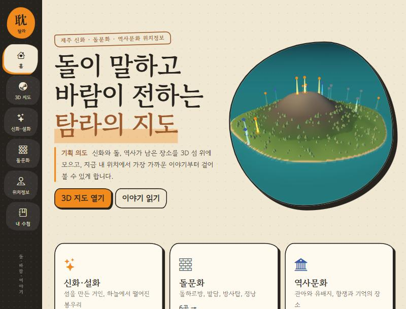
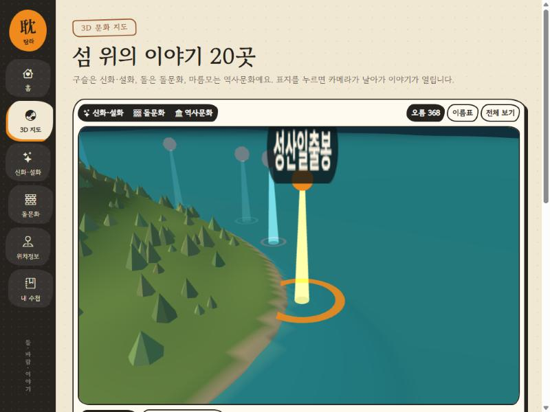
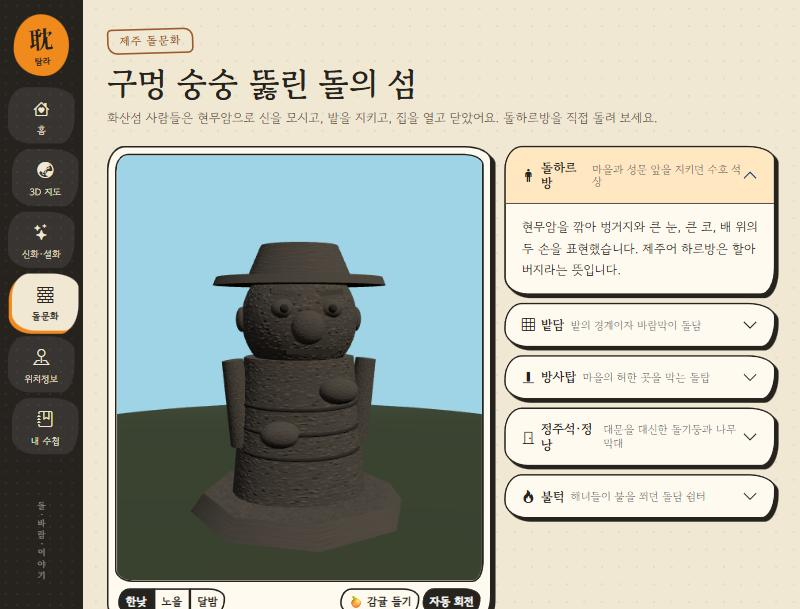

<div align="center">

# 耽 탐라 이야기 수첩

### 돌이 말하고, 바람이 전하는 섬 — 제주 신화·돌문화·역사문화를 3D 지도로




</div>

---

## ✨ 한눈에 보기

> **기획 의도** — 신화와 돌, 역사가 남은 장소를 3D 섬 위에 모으고, 지금 **내 위치에서 가장 가까운 이야기**부터 걸어 볼 수 있게 합니다.

| | 갈래 | 담은 것 | 지도 표지 |
|---|---|---|---|
| 🟠 | **신화·설화** | 설문대할망, 오백장군, 산방산, 삼성혈, 영등할망 등 8곳 | 구슬 |
| ⚪ | **돌문화** | 돌하르방, 밭담, 방사탑, 정낭, 불턱, 돌문화공원 6곳 | 돌 |
| 🔵 | **역사문화** | 제주목 관아, 항파두리, 4·3평화공원, 추사 유배지 등 6곳 | 마름모 |

## 🗺️ 주요 기능

<table>
<tr>
<td width="50%"></td>
<td width="50%"></td>
</tr>
<tr>
<td align="center"><b>3D 문화 지도</b><br/>실제 위·경도로 세운 제주 섬. 표지를 누르면 카메라가 날아갑니다.</td>
<td align="center"><b>돌하르방 3D</b><br/>현무암 질감 모델. 한낮·노을·달밤 조명, 감귤 소품.</td>
</tr>
</table>

- **3D 문화 지도** — 한라산과 오름 368개, 파도치는 바다, 레이어(신화·돌문화·역사문화) 켜고 끄기
- **내 위치 연동** — Geolocation으로 가까운 장소 거리 계산·정렬, 3D 지도에 *내 위치* 표시 (권한이 없으면 제주시청 기준 체험 모드)
- **신화·설화 읽기** — 갈래별 필터와 전체 이야기 모달, "지도에서 보기"로 바로 이동
- **돌문화 도감** — 돌하르방·밭담·방사탑·정낭·불턱 해설 + 돌하르방 3D 뷰어
- **공공데이터 연동** — 한국관광공사 TourAPI 위치기반 조회, 국가유산청 국가유산, 기상청 단기예보
- **내 수첩** — 북마크한 장소를 브라우저에 보관하고, 세 갈래 수집 진행도를 표시

## 🎨 디자인 컨셉 — "한지 · 현무암 · 돌 도장"

Bootstrap 5를 기반으로 하되 컴포넌트를 **제주의 돌담**처럼 다시 입혔습니다.

- **현무암 레일** — 왼쪽 세로 내비게이션을 돌을 엇갈려 쌓듯 배치 (모바일에서는 Offcanvas)
- **돌 도장 카드** — 손으로 깎은 듯 비대칭 둥근 모서리 + 두꺼운 테두리 + 단단한 그림자
- **색** — 한지 `#f1e8d4`, 현무암 `#26231f`, 갈옷 `#9c5a2c`, 감귤 `#f08a1c`, 바다 `#1e8a9a`
- **글꼴** — 제목 *Gowun Batang*(명조), 본문 *Gowun Dodum*

## 🧱 폴더 구조

```
project/
├─ api/                 Vercel 서버 함수 (주소 = /api/파일이름) — 비밀 키는 여기서만
│  ├─ hello.js            동작 확인
│  ├─ tour.js             한국관광공사 (위치기반·키워드)
│  ├─ heritage.js         국가유산청
│  └─ weather.js          기상청
├─ server/              공공 API 호출 함수 (api/ 가 import)
├─ src/
│  ├─ main.jsx            Bootstrap + 테마 CSS + 라우터 시작
│  ├─ router.jsx          메뉴(NAV_ITEMS) + 주소별 페이지
│  ├─ layouts/            공통 틀 (돌 레일, 모바일 Offcanvas)
│  ├─ pages/              Home · MapPage · Myth · Stone · Places · Notebook
│  ├─ components/         ThreeStage(3D 공통 래퍼) · JejuMapView · ui(뱃지·저장·위치)
│  ├─ scenes/             terrain(지형) · jejuMap(지도 장면) · harbang(돌하르방) · helpers
│  ├─ data/               places(20곳) · stones(돌문화 해설)
│  ├─ store/              Zustand 전역 상태 (수첩·레이어·내 위치)
│  ├─ lib/geo.js          하버사인 거리 계산
│  └─ api/client.js       화면 → /api 호출
└─ docs/                README 스크린샷
```

## 🚀 실행하기

```bash
npm install
cp .env.example .env.local     # 공공데이터포털 키 입력 (선택)
npm run dev                    # http://localhost:5173
```

`npm run dev` 만으로도 `/api/*` 서버 함수가 동작합니다. (`vite.config.js`의 개발용 미들웨어가 `api/` 폴더를 그대로 불러 줍니다. 배포 시에는 Vercel이 같은 파일을 서버 함수로 실행합니다.)

> 키가 없어도 3D 지도·신화·돌문화·수첩은 모두 동작합니다. 공공데이터 탭(내 주변·국가유산)과 날씨만 키가 필요합니다.

### 환경변수

| 이름 | 용도 | 비고 |
|---|---|---|
| `DATA_GO_KR_KEY` | 한국관광공사 TourAPI · 기상청 단기예보 | 공공데이터포털 **Decoding 키**. 브라우저에 노출되지 않음 |

국가유산청 API는 키가 필요 없습니다.

## 🌐 사용한 공공데이터

| API | 엔드포인트 | 화면 |
|---|---|---|
| 한국관광공사 국문 관광정보(KorService2) | `/api/tour?lat=&lng=&radius=` | 위치정보 › 내 주변 |
| 국가유산청 국가유산 검색 | `/api/heritage?keyword=` | 위치정보 › 국가유산 |
| 기상청 단기예보 | `/api/weather?place=` | 홈, 국가유산 탭 |

## 🧠 구현 메모

- **지형 생성** — 외부 모델 없이 높이함수(섬 윤곽 + 한라산 가우시안 + 기복)로 메시를 만들고, 높이에 따라 정점 색을 입힙니다. 오름 368개는 고정 시드로 `InstancedMesh`에 배치합니다.
- **3D ↔ React 연결** — `ThreeStage`가 렌더 루프·리사이즈·정리(dispose)를 맡고, 장면은 React 값을 담은 `live` ref를 읽습니다. 상태가 바뀌어도 장면을 다시 만들지 않습니다.
- **위치정보** — `navigator.geolocation` → 하버사인 거리 → 정렬/표시. 3D에서는 섬 밖 위치도 장면 안에 머물도록 범위를 제한합니다.

## ⚠️ 알아두기

- **전승은 지역과 채록자에 따라 다릅니다.** 대표적인 이야기를 요약한 것이며, 발표·배포 전 검수가 필요합니다.
- 지도의 **좌표는 대략적인 위치**입니다. 정확한 위치는 공공데이터 탭을 이용하세요.
- 공공데이터 API 연동은 키 없이 검증하지 못했습니다. 키를 넣은 뒤 `/api/hello`, `/api/tour?lat=33.5&lng=126.53` 으로 먼저 확인하세요.

---

<div align="center">
제주대 청년도약 부트캠프 · 제주 IP 프로젝트<br/>
<sub>돌 · 바람 · 이야기</sub>
</div>
