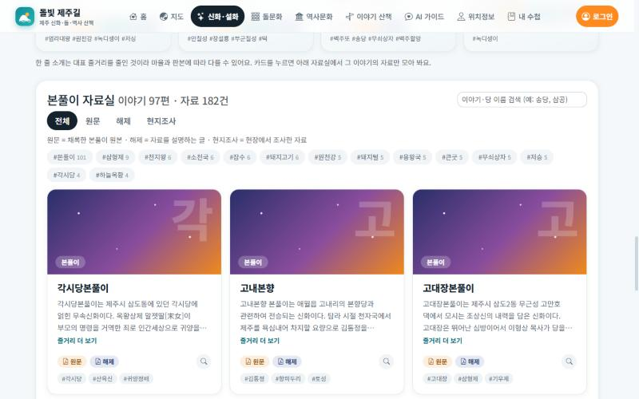
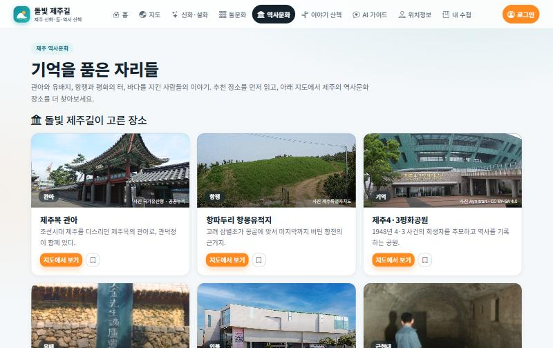
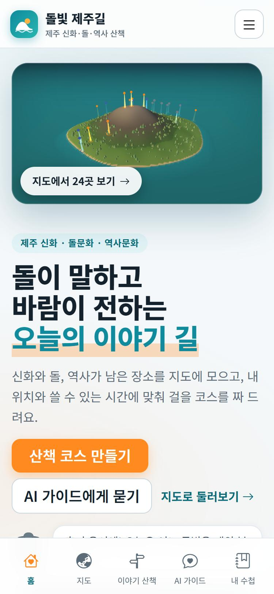
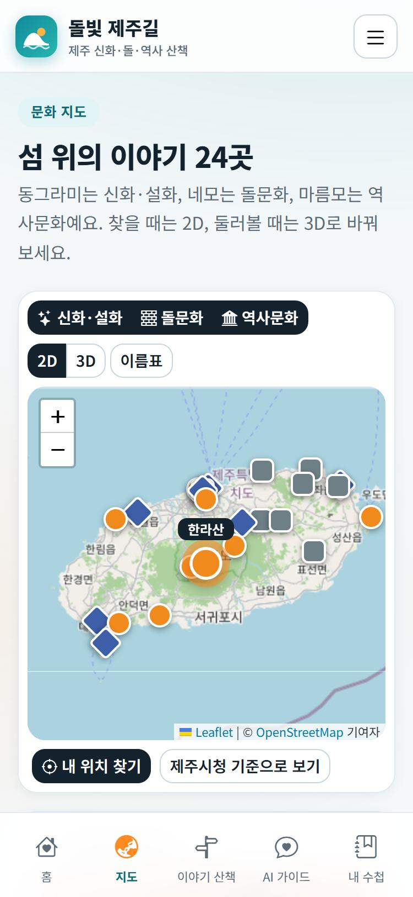
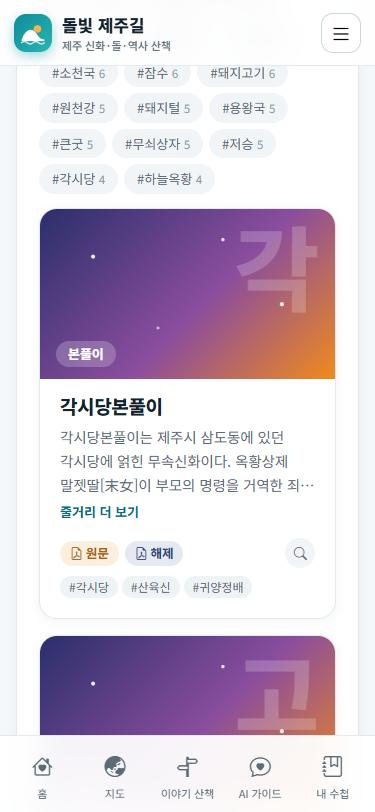

<div align="center">


# 🌋 돌빛 제주길

### 돌이 말하고, 바람이 전하는 섬 — 오늘 걸을 제주 이야기 길을 짜 드립니다

신화 · 돌문화 · 역사문화가 남은 제주의 장소 **24곳**을 지도에 모으고,<br/>
**내 위치와 쓸 수 있는 시간에 맞춰 산책 코스**를 만들어 주는 웹 서비스


[만든 이유](#-만든-이유) ·
[미리보기](#-미리보기) ·
[기능](#-주요-기능) ·
[콘텐츠](#-담은-이야기-24곳) ·
[공공데이터](#-사용한-공공데이터-api) ·
[시작하기](#-시작하기) ·
[구조](#-폴더-구조) ·
[사진 출처](#-사진-출처와-라이선스) ·
[알아두기](#-알아두기)

</div>

---

## 📊 한눈에 보기

| 📍 장소 | 📖 본풀이 | 🪨 소장 유물 | 🖼️ 신화 사진·삽화 | 🏛️ 국가유산 사진 | 🔌 공공 API |
|:---:|:---:|:---:|:---:|:---:|:---:|
| **24곳** | **97편** (자료 182건) | **77점** | **129점** | **14곳** | **10개** |

## 💡 만든 이유

제주 여행 앱은 많지만, 신화·돌문화·역사 이야기를 **"오늘 내가 걸을 수 있는 길"** 로 묶어 주는 곳은 드뭅니다.
돌빛 제주길은 세 가지를 합니다.

- 🧭 **모읍니다** — 설문대할망의 한라산부터 4·3평화공원까지, 이야기가 남은 장소 24곳을 사진·현장 정보와 함께 담았습니다.<br/>
  <sub>지도 · 신화·설화 · 돌문화 · 역사문화</sub>
- 🚶 **짭니다** — 출발지·시간·이동수단·날씨(비)·동행(아이)을 고르면 가까운 곳부터 코스를 묶고, 이동 시간과 길찾기까지 이어 줍니다.<br/>
  <sub>이야기 산책 · AI 가이드</sub>
- 🔖 **남깁니다** — 장소마다 도장을 찍고, 담은 장소·저장한 코스와 함께 계정 수첩에 보관합니다.<br/>
  <sub>내 수첩</sub>

---

## 📸 미리보기

<table>
<tr>
<td width="50%"></td>
<td width="50%"></td>
</tr>
<tr>
<td align="center"><b>🚶 이야기 산책</b><br/>시간·이동수단·갈래로 코스를 짜고, 장소마다 도장을 찍습니다.</td>
<td align="center"><b>💬 AI 가이드</b><br/>"아이와 1시간, 비 오는 날"처럼 말하면 도구를 불러 코스를 만듭니다.</td>
</tr>
<tr>
<td width="50%"></td>
<td width="50%"></td>
</tr>
<tr>
<td align="center"><b>🗺️ 2D · 3D 문화 지도</b><br/>OpenStreetMap 실제 지도 위의 2D, 오름 368개가 있는 3D.</td>
<td align="center"><b>🪨 돌 전시 3D</b><br/>오른쪽에서 돌을 고르면 3D 모델과 카메라가 바뀝니다.</td>
</tr>
<tr>
<td width="50%"></td>
<td width="50%"></td>
</tr>
<tr>
<td align="center"><b>✨ 신화·설화</b><br/>제주도청 사진·삽화가 붙은 카드, 눌러서 전문을 읽습니다.</td>
<td align="center"><b>📖 본풀이 자료실</b><br/>같은 이야기의 원문·해제·현지조사를 한 카드에, 줄거리와 PDF까지.</td>
</tr>
<tr>
<td colspan="2" align="center"><br/><b>🏛️ 역사문화</b> — 추천 장소 7곳 카드와 제주역사문화위치정보 지도·목록.</td>
</tr>
</table>

### 📱 휴대폰에서도

<table>
<tr>
<td width="33%" align="center"><br/><b>홈</b></td>
<td width="33%" align="center"><br/><b>지도</b> — 마커를 누르면 상세로 이동</td>
<td width="33%" align="center"><br/><b>본풀이</b></td>
</tr>
</table>

하단 탭바(홈·지도·이야기 산책·AI 가이드·내 수첩)와 햄버거 메뉴로 어디서든 쓰기 편하게 만들었습니다.

---

## 🧭 주요 기능

| | 기능 | 설명 |
|:---:|---|---|
| 🚶 | **코스 만들기** | 가까운 곳부터 고르되 같은 갈래가 몰리지 않게 점수를 줍니다. 비 오는 날은 실내·우천 가능 장소만, 아이와 함께는 아이에게 맞는 장소를 우대합니다. (`src/lib/course.js`) |
| ⏱️ | **어림값 표시** | 이동 시간은 직선거리에 우회 계수를 곱한 값이라, 구간마다 **어림값** 뱃지를 붙이고 실제 길찾기는 장소마다 있는 길찾기 버튼(카카오맵 링크)으로 잇습니다. |
| 🕘 | **방문 전 확인 안내** | 전시·기념관 8곳은 한국관광공사 소개정보의 **쉬는 날·이용 시간·요금**을 보여 줍니다. 못 찾으면 시간을 지어내지 않고 "방문 전 확인" 안내와 카카오맵 링크만 줍니다. |
| 🏷️ | **방문 도장** | 장소 500m 안에서 찍으면 **현장 도장**, 아니면 **체험 도장**입니다. 찍을 때 도장이 눌리는 효과와 진행도가 나옵니다. |
| 💬 | **AI 가이드** | 서버에 도구 5개(코스 짜기 · 날씨 · 주변 관광정보 · 장소 검색 · 신화 아카이브 검색)를 두었습니다. `ANTHROPIC_API_KEY`가 있으면 Claude가 도구를 골라 부르고, 없으면 규칙 기반 가이드가 같은 도구를 직접 부릅니다. 화면에 어느 쪽이 답했는지 표시합니다. |
| 📖 | **본풀이 자료실** | 제주도청 신화 자료 182건을 **이야기 97편**으로 묶었습니다. 카드 하나에 원문·해제·현지조사 칩이 있고, 칩을 누르면 도청 문서뷰어로 PDF가 열립니다. 줄거리는 '해제' 자료의 개요를 그대로 옮겼습니다. |
| 🪨 | **돌 전시 3D** | 오른쪽 설명을 고르면 모델이 커지며 바뀌고 카메라가 따라갑니다. 정낭은 *정낭 걸기* 버튼으로 막대를 걸어 볼 수 있고, 불턱에서는 불이 흔들립니다. 돌하르방은 한낮·노을·달밤 조명과 감귤 소품이 있습니다. |
| 🗺️ | **2D · 3D 지도** | 실제 지도(2D)와 지형을 직접 만든 3D를 오갑니다. 좁은 화면에서는 마커를 누르면 상세 카드로 이동하고 *지도로 돌아가기*가 나옵니다. |
| 🔗 | **코스 저장·공유** | *이 코스 저장*으로 내 수첩에 보관(최대 20개), *친구에게 공유*는 휴대폰에서는 공유 시트, 컴퓨터에서는 링크 복사입니다. 받은 사람은 **자기 위치에서** 같은 순서의 코스를 봅니다. (`/walk?ids=장소순서&mode=이동수단`) |
| ☁️ | **계정 수첩** | 로그인하면 담은 장소·도장·저장한 코스를 계정에 저장하고 기기를 바꿔도 이어집니다. 불러오기에 실패하면 저장하지 않아 빈 값으로 덮어쓰지 않습니다. |
| 🔌 | **공공데이터 연결** | 장소 상세·산책 카드에서 *주변 볼거리·맛집*을 누르면 한국관광공사 데이터를 불러옵니다. |

### 🪨 세계관과 캐릭터 — 돌이

> **돌은 이야기를 기억해요.** 제주는 돌이 이야기를 기억하는 섬이고, 현무암의 구멍마다 이야기가 숨 쉬던 자리가 있습니다. 사람이 그곳에서 이야기를 들으면 구멍에서 따뜻한 빛, **돌빛**이 새어 나옵니다. 돌빛은 24곳에 숨어 있고, 도장을 찍을 때마다 하나씩 켜집니다.

**돌이**는 벙거지를 쓴 아기 돌하르방으로, 이야기를 들려주고 돌빛을 깨우는 길을 안내합니다. 감귤과 바람 소리를 좋아하고, 짧고 다정한 해요체로 말하며 제주 인사말(혼저 옵서예, 폭삭 속았수다)은 가끔만 씁니다.

| 어디서 만나나 | 돌이가 하는 일 |
|---|---|
| 홈 | 인사 말풍선과 "돌빛 세계" 소개 카드 |
| 이야기 산책 | 장소마다 한마디(갈래·장소별), 도장을 찍으면 도장 말 — 4·3처럼 무거운 장소에서는 차분하게 |
| AI 가이드 | 프로필 카드, 답변 옆 아바타, Claude 경로에서는 돌이 말투 지시(`server/guide.js`) |
| 내 수첩 | **돌빛 단계**(잠든 돌 → 깨어나는 돌 → 반짝이는 돌 → 빛나는 돌 → 돌빛 지킴이 → 돌빛 완성)와 갈래별 뱃지(별빛 이야기꾼 · 돌담 지킴이 · 기억 지킴이) |

돌이는 SVG로 직접 그렸고(`src/components/Doli.jsx`, 기분 4가지와 돌빛 세기 조절), 설정과 대사는 `src/data/world.js`에 모았습니다. **이 세계관은 서비스가 만든 창작 이야기이며 제주의 전승이 아닙니다.** 화면에도 그렇게 적혀 있습니다.

### 📄 페이지별로 보면

| 페이지 | 주소 | 하는 일 |
|---|---|---|
| 🏠 **홈** | `/` | 오늘의 코스(2시간)와 출발지 바꾸기, 세 걸음 사용법, 세 가지 이야기, 돌빛 세계 소개 |
| 🗺️ **지도** | `/map` | 2D(실제 지도, 기본)와 3D 전환, 갈래별 레이어, 장소 상세·길찾기·주변 볼거리, 방문 전 확인 안내 |
| 🚶 **이야기 산책** | `/walk` | 코스 만들기, 장소별 이동(어림값)·머묾 시간·현장 팁·도장·길찾기, **코스 저장과 링크 공유** |
| 💬 **AI 가이드** | `/guide` | 말로 묻고 코스를 받아 산책 화면으로 열기 |
| ✨ **신화·설화** | `/myth` | 장소로 만나는 설화 9편(사진·삽화), **전설의 사진과 그림** 갤러리(제주신화정보 129점), **제주 본풀이** — 대표 8편 소개 카드와 자료실(97편) |
| 🪨 **돌문화** | `/stone` | 돌 5종 3D 전시(돌하르방·밭담·방사탑·정주석과 정낭·불턱), 돌문화공원 소장 유물(77점) |
| 🏛️ **역사문화** | `/history` | 추천 장소 7곳 카드 + 제주역사문화위치정보 지도·목록(장소를 고르면 제주역사문화일반정보의 설명 글을 함께 보여 줌, 검색·거리순, 목록을 못 불러오면 추천 7곳을 대신 보여 주고 연결되면 자동으로 전체 목록으로 바뀜) |
| 📍 **위치정보** | `/places` | 추천 장소 표, 내 주변, 국가유산(읍·면·동 지역명 표시) |
| 🔖 **내 수첩** | `/notebook` | 돌빛 단계·뱃지, **저장한 코스**(열기·공유·이름 바꾸기·삭제), 담은 장소, 돌빛 도장판(n/24), 계정 저장 상태 |
| 🔑 **로그인** | `/login` | 가입·로그인 (Supabase, 키가 없으면 체험 모드) |

---

## 📍 담은 이야기 24곳

| 갈래 | 지도 표지 | 장소 |
|---|:---:|---|
| 🟠 **신화·설화** 9 | ● 동그라미 | 한라산(설문대할망) · 영실 오백장군 · 물장오리 · 산방산 · 성산일출봉 · 삼성혈 · 귀덕 복덕개(영등할망) · 용두암 · 천제연폭포(칠선녀) |
| ⚪ **돌문화** 8 | ■ 네모 | 제주돌문화공원 · 관덕정 일대 돌하르방 · 북촌리 방사탑 · 구좌 밭담 지대 · 성읍민속마을 · 하도리 해녀 불턱 · 만장굴 · 거문오름 |
| 🔵 **역사문화** 7 | ◆ 마름모 | 제주목 관아 · 항파두리 항몽유적 · 제주4·3평화공원 · 추사 유배지 · 김만덕기념관 · 알뜨르 비행장 · 해녀박물관 |

장소마다 요약, 이야기 전문, 키워드와 함께 **머무는 시간 · 현장에서 볼 것 · 팁 · 비 오는 날/아이와 가기 좋은지**(`src/data/walk.js`)를 담았습니다.

---

## 🌐 사용한 공공데이터 API

브라우저는 `/api`만 부르고, 공공데이터 키는 서버 함수에서만 씁니다.

| API | 키 | 엔드포인트 | 화면 |
|---|:---:|---|---|
| 한국관광공사 국문 관광정보(KorService2) | 🔑 | `/api/tour` · `/api/place?kind=photo` | 장소 사진, 주변 볼거리·맛집, 위치정보 › 내 주변 |
| 한국관광공사 소개정보 조회(`detailIntro2`) | 🔑 | `/api/place?kind=info` | 전시·기념관 8곳의 쉬는 날·이용 시간·요금 |
| 국가유산청 국가유산 검색·상세 | | `/api/heritage?keyword=` | 위치정보 › 국가유산(소재지에서 읍·면·동을 뽑아 표시) |
| 국가유산청 국가유산 이미지검색 | | `/api/place?kind=khs` ← `khs.go.kr/cha/SearchImageOpenapi.do` | 장소 사진(국가유산인 14곳) |
| 기상청 단기예보 | 🔑 | `/api/weather?place=` | 홈, AI 가이드(비 확인) |
| 제주 신화 콘텐츠 (제주도청) | | `/api/myth` ← `jeju.go.kr/rest/JejuMythContents/…` | 본풀이 자료실(제목·구분·태그·PDF), AI 가이드 |
| 제주신화정보 이미지 (제주도청) | | `/api/mythmedia` ← `jeju.go.kr/tool/openapi/jejumythservice/jejumythlist/` | 설화 카드 사진·삽화, 전설의 사진과 그림, 본풀이 삽화 |
| 제주돌문화공원 소장유물 (제주도청) | | `/api/stonepark` ← `jeju.go.kr/api/jejustonepark/have/` | 돌문화 › 소장 유물 |
| 제주역사문화위치정보 (공공데이터포털 15109570) | 🔑 | `/api/history` ← `api.odcloud.kr` | 역사문화 › 위치(지도 + 목록) |
| 제주역사문화일반정보 (공공데이터포털 15109587) | 🔑 | `/api/historyinfo` ← `api.odcloud.kr` | 역사문화 › 장소 설명 글 |
| AI 가이드(자체) | 선택 | `/api/guide?q=&lat=&lng=` | AI 가이드 |

> 🔑 = `DATA_GO_KR_KEY` 필요. 키가 없는 칸의 API만으로도 지도·신화·돌문화·산책·AI 가이드(기본)가 동작합니다.

---

## 🧰 기술 스택

| 영역 | 사용 |
|---|---|
| 화면 | React 19 · React Router 7 · Zustand 5 · Bootstrap 5 + react-bootstrap · bootstrap-icons |
| 3D | three.js (도형으로 직접 만든 지형·오름·돌 모델) |
| 지도 | Leaflet + OpenStreetMap 타일 |
| 서버 함수 | `api/` + `server/` (Vercel 방식, 개발 중에는 Vite 미들웨어가 대신 실행) |
| 로그인·저장 | Supabase Auth + `notebooks` 테이블(RLS) — 키가 없으면 브라우저 체험 모드 |
| AI | Claude Messages API의 도구 호출(tool use) — 키가 없으면 규칙 기반 대체 |
| 빌드 | Vite 6 |

## 🚀 시작하기

```bash
npm install
cp .env.example .env.local     # 키 입력 (모두 선택)
npm run dev                    # http://localhost:5173
```

`npm run dev`만으로도 `/api/*`가 동작합니다. (`vite.config.js`의 개발용 미들웨어가 `api/` 폴더를 그대로 불러 줍니다. 배포할 때는 Vercel이 같은 파일을 서버 함수로 실행합니다.)

```bash
npm run build      # dist/ 로 빌드
npm run preview    # 빌드 결과 미리보기
```

> 키가 없어도 지도 · 신화 · 돌문화 · 산책 · 도장 · 체험 모드 로그인 · 기본 AI 가이드 · 본풀이 · 소장 유물 · 국가유산 검색은 동작합니다.

### 🔐 환경변수

`.env.local`에 넣습니다. (git에는 올라가지 않습니다)

| 이름 | 용도 | 비고 |
|---|---|---|
| `DATA_GO_KR_KEY` | 한국관광공사(사진·주변·이용 정보) · 기상청 · 제주역사문화위치정보 · 제주역사문화일반정보 | 공공데이터포털 **일반 인증키의 Decoding 값** 하나(Encoding 값을 넣어도 서버가 한 번 풀어서 씁니다). 데이터마다 활용신청이 필요합니다 |
| `VITE_SUPABASE_URL` · `VITE_SUPABASE_ANON_KEY` | 로그인·회원가입, 계정 수첩 | `anon` 키(공개용)만 넣고 `service_role`은 넣지 마세요. 비우면 체험 모드 |
| `ANTHROPIC_API_KEY` | AI 가이드(Claude 에이전트) | 서버 전용 — 앞에 `VITE_`를 붙이지 마세요. `ANTHROPIC_MODEL`로 모델 변경 가능 |

값을 바꾼 뒤에는 개발 서버를 다시 시작하세요.

### 🗄️ Supabase 설정 (선택)

1. Supabase 프로젝트를 만들고 **SQL Editor**에서 [`supabase/schema.sql`](supabase/schema.sql)을 실행합니다. (예전에 만든 테이블이면 같은 파일의 `alter table … add column courses` 줄만 실행해도 됩니다. 이 열이 없으면 저장한 코스는 계정에 저장되지 않고 이 기기에만 남아요.)
2. **Settings → API**의 Project URL과 `anon` `public` 키를 `.env.local`에 넣습니다.
3. 이메일 확인을 켜 두었다면 가입 후 메일의 링크를 눌러야 로그인됩니다.

### ▲ 배포 (Vercel)

`vercel.json`이 있어 SPA 주소가 동작합니다.

> ⚠️ Vercel **무료(Hobby) 플랜은 서버 함수를 배포당 12개까지** 허용하고, `api/` 폴더의 파일 하나가 함수 하나입니다. 지금은 11개라 **새 API 파일을 추가하면 배포가 실패**할 수 있어요. 비슷한 것은 `api/place.js`처럼 `?kind=` 로 한 파일에 모으세요.
 Vercel 프로젝트 환경변수에 위 이름을 그대로 등록하세요. 배포 후에는 아래 주소로 연결 상태를 확인할 수 있습니다.

| 확인 주소 | 보는 것 |
|---|---|
| `/api/place?kind=photo&debug=1` | 한국관광공사 사진을 못 찾은 장소와 그 이유 |
| `/api/place?kind=info&debug=1` | 이용 정보를 못 찾은 장소, 응답 필드 이름 |
| `/api/stonepark` | 응답의 `snapshot`이 `true`면 도청 연결이 막혀 저장본을 쓰는 중 |

공개 배포 전에는 아래 [알아두기](#-알아두기)의 호출 제한과 지도 타일 정책을 먼저 확인하세요.

### 🔄 데이터 다시 만들기

| 명령 | 만드는 것 |
|---|---|
| `node scripts/build-myth-summary.mjs` | 본풀이 줄거리 `src/data/mythSummary.json` — 도청 PDF 변환본의 '1 개요'를 뽑아 저장 |
| `node scripts/build-relics-snapshot.mjs` | 소장 유물 저장본 `server/data/relics.js` — 도청 API를 못 읽을 때 대신 쓰는 77점 |

---

## 🧱 폴더 구조

```
project/
├─ api/                    서버 함수 (주소 = /api/파일이름) — 비밀 키는 여기서만
│  ├─ tour · place · heritage · weather                                관광공사·국가유산청·기상청  (place = 사진·이용 정보·국가유산 이미지, kind 로 구분)
│  ├─ myth · mythmedia · stonepark                                   제주도청 (키 없음)
│  ├─ history · historyinfo                                          제주역사문화 (odcloud)
│  └─ guide · hello                                                  AI 가이드 · 상태 확인
├─ server/                 공공 API·에이전트 호출 함수 (api/ 가 import)
│  ├─ jejugo.js              제주도청 API 3종 (XML 파싱·전체 페이지 수집·캐시·실패 시 저장본)
│  ├─ guide.js               도구 5개 + Claude 호출 루프 + 규칙 기반 대체
│  ├─ tour · placephoto · placeinfo · heritage · khsphoto · weather · history · historyinfo
│  └─ data/relics.js         소장 유물 저장본
├─ scripts/                데이터 만들기 (본풀이 줄거리, 유물 저장본)
├─ supabase/schema.sql     notebooks 테이블 + RLS
├─ src/
│  ├─ router.jsx             메뉴(NAV_ITEMS)와 주소별 페이지
│  ├─ layouts/               상단 내비, 모바일 탭바·메뉴, 계정 버튼
│  ├─ pages/                 Home · MapPage · Walk · Guide · Myth · Stone · History · Places · Notebook · Login
│  ├─ components/            RealMap(2D) · JejuMapView(3D) · ThreeStage · Doli(캐릭터) · MythArt(일러스트)
│  │                         Bonpuri(본풀이) · MythGallery · RelicShelf · HistoryPlaces · ui
│  ├─ scenes/                terrain · jejuMap · harbang(돌 전시) · helpers  (three.js)
│  ├─ data/                  places(24곳) · walk(현장 정보) · world(세계관) · bonpuri(대표 8편) · mythSummary(줄거리)
│  │                         mythMedia · photoQuery · khsPhoto · webPhotos(사진 출처) · stones(돌문화 해설)
│  ├─ store/                 useAppStore(수첩·도장·지도) · useAuthStore(로그인)
│  ├─ lib/                   geo · course(코스 알고리즘) · photos · placeinfo · share · auth · cloud · sync · info
│  ├─ api/client.js          화면 → /api 호출
│  └─ styles/theme.css       Bootstrap 위에 덧입힌 테마
└─ docs/                   README 스크린샷
```

## 🧠 구현 메모

- **지형 생성** — 외부 모델 없이 높이함수(섬 윤곽 + 한라산 가우시안 + 기복)로 메시를 만들고, 높이에 따라 정점 색을 입힙니다. 오름 368개는 고정 시드의 `InstancedMesh`입니다.
- **3D ↔ React 연결** — `ThreeStage`가 렌더 루프·리사이즈·정리(dispose)를 맡고, 장면은 React 값을 담은 `live` ref를 읽습니다. 상태가 바뀌어도 장면을 다시 만들지 않습니다.
- **돌 전시** — 모델 5개를 한 장면에 만들어 두고, 선택한 것만 커지며 나타납니다. 돌은 꼭짓점을 위치 기준으로 흔든 이십면체(현무암 질감)이고, 밭담·방사탑·불턱은 난수 시드를 고정해 새로고침해도 모양이 같습니다.
- **코스 알고리즘** — 현재 위치에서 시간 안에 들어가는 후보 중 `이동 시간 + 같은 갈래 가산점 − 아이 동반 가산점`이 가장 낮은 곳을 반복해서 고릅니다. 화면과 서버(AI 도구)가 같은 함수를 씁니다.
- **에이전트** — 서버가 도구를 Claude에 노출하고 `tool_use`가 끝날 때까지 최대 6번 반복합니다. 코스의 사실(시간·거리·장소)은 도구 결과에서만 가져오게 지시했습니다.
- **사진 합치기** — 출처 네 곳의 사진을 장소마다 하나로 고릅니다(`src/lib/photos.js`). 비슷한 곳의 사진으로 때우지 않고, 없으면 그 장소를 그린 일러스트를 씁니다.
- **본풀이 묶기** — 같은 이야기는 이름(공백·괄호·끝 숫자를 지우고 "본푸리"를 "본풀이"로 맞춤)으로 묶고, 줄거리는 '해제' 자료의 개요를 같은 이름의 원문·현지조사에도 붙입니다. 도청 문서뷰어의 변환본은 글자마다 좌표가 있어서, 같은 줄의 글자를 모아 줄을 되살리고 그 안에서 '1 개요'를 뽑습니다.
- **PDF 열기** — 신화 API 응답의 `pdfUrl`(`files/board/<uuid>.pdf`)은 직접 열면 404라서, 도청 문서뷰어 주소(`…/doc.html?fn=<uuid>.pdf&rs=/files/convert2020/201708/`)로 바꿔 씁니다. 182건 모두 변환본이 있는 것을 확인했습니다. 전자책(`ebookUrl`) 주소는 모두 404라 쓰지 않습니다.
- **제주도청 API 다루기** — 신화 이미지 API는 주소 끝에 `/`가 없으면 307로 되돌려 보내고, `pageSize`를 크게 주면 182건을 한 번에 받습니다. 신화 API는 조건 파라미터를 무시하고 전체 182건을 주고, 유물 API는 한 페이지 9건 고정이라, 서버에서 전체를 받아 걸러 냅니다. 유물은 재시도·쪽수 제한 후에도 못 읽으면 저장본으로 답합니다.
- **캐시** — 제주도청 1시간 · 관광공사 사진 6시간 · 이용 정보·국가유산 사진·소재지 24시간. Vercel은 서버 함수 메모리가 공유되지 않아 응답 자체에도 `s-maxage`를 줘서 일일 호출 한도를 아낍니다.
- **수첩 동기화** — 로그인하면 계정 수첩을 불러와 로컬과 합집합으로 합친 뒤 변경마다 저장하고, 로그아웃하면 이 기기의 수첩을 비웁니다.

## 🎨 디자인 — "제주 블루 · 감귤 오렌지"

Bootstrap 5 위에 **밝고 깔끔한 여행 앱** 느낌의 테마를 입혔습니다.

| 🌊 바다 | 🍊 감귤 | 🖋️ 잉크 | 🪟 배경 |
|:---:|:---:|:---:|:---:|
| `#0f8b9d` | `#ff8a1f` | `#13222d` | `#f4f8fa` |

- 넓은 화면은 상단 내비게이션, 모바일은 **하단 탭바**와 햄버거 메뉴
- 흰 카드 · 얇은 테두리 · 부드러운 그림자 · 둥근 모서리, 글꼴 Noto Sans KR
- 장소 카드는 **사진**, 사진이 없으면 갈래별 무늬(신화 별빛 · 돌문화 현무암 · 역사문화 기와선)나 직접 그린 일러스트
- 도장 효과, 오름·해·파도 로고(헤더·파비콘), 시스템의 "동작 줄이기" 설정이면 움직임을 끕니다

---

## 📷 사진 출처와 라이선스

장소마다 아래 네 곳에서 사진을 찾고, 사진 위에 **출처를 항상 표시**합니다. 맞는 사진이 없으면 비슷한 곳의 사진으로 때우지 않고 그 장소를 직접 그린 일러스트(`src/components/MythArt.jsx`)를 씁니다.

| # | 출처 | 키 | 화면 표시 | 쓰는 곳 |
|:---:|---|:---:|---|---|
| ① | **제주신화정보** (제주도청 OpenAPI) | | *사진·삽화 제주특별자치도* | 신화·설화 장소(신화 장소는 이것을 먼저). 전자책 표지는 출판사 저작물이라 쓰지 않음 |
| ② | **한국관광공사 TourAPI** 대표 이미지 | 🔑 | *사진 한국관광공사 · 유형* | 그 밖의 장소. **관광지·문화시설 종류만**, 좌표 8km 안, 제목이 장소 이름과 맞는 것 |
| ③ | **국가유산청 국가유산 이미지** | | *사진 국가유산청 · 공공누리* | 성산일출봉·물장오리·거문오름·만장굴·산방산·천제연·제주목 관아·삼성혈·항파두리·성읍·추사적거지·관덕정 돌하르방·알뜨르·용두암 14곳. **공공누리 A·B 유형만** |
| ④ | **위키미디어 커먼즈** 등 | | *사진 작성자 · 라이선스* | 위 셋에 없을 때 마지막으로 13곳(CC0 · CC BY-SA · 공공누리 제1유형 · 퍼블릭 도메인). 상세 화면에서는 원본 페이지로 연결 |

- 신화·설화 장소는 ①을, 나머지는 ②를 먼저 쓰고, 없으면 서로 대신합니다. 사진이 장소와 안 맞는 경우(관덕정 돌하르방은 ①이 건물 사진)는 `first: true`로 맞는 사진을 먼저 씁니다.
- 위키미디어 사진의 작성자·라이선스는 `src/data/webPhotos.js`에 사진마다 적혀 있습니다. 방사탑 사진은 북촌이 아닌 용수리 방사탑이고 사진 제목에도 그렇게 적혀 있습니다.
- 한국관광공사 사진은 `DATA_GO_KR_KEY`가 있어야 나옵니다. 키가 없으면 ①·③·④와 일러스트로 채워집니다.

> ⚠️ **김만덕기념관 사진**은 자유 이용 사진을 찾지 못해 **제주소리**(제주 지역 신문)의 기념관 사진(`cdn.jejusori.net`)을 골라 쓰고 *사진 제주소리*로 출처를 밝힙니다. 이 사진은 이용 허락·라이선스 표기가 없는 **보도 사진**이라, 공개 서비스로 운영하려면 제주소리의 허락을 받거나 다른 사진으로 바꿔야 합니다.

---

## 🚧 알아두기

- **이동 시간은 어림값입니다.** 직선거리에 우회 계수(자동차 1.35, 걷기 1.25)를 곱한 값이라 실제와 차이가 큽니다. 일정을 짤 때는 길찾기 버튼으로 다시 확인하세요. 대중교통 모드는 없습니다.
- **운영 시간·휴관일은 바뀔 수 있습니다.** 한국관광공사 소개정보를 보여 주지만, 공사 정보도 최신이 아닐 수 있어 방문 전 확인 링크를 함께 둡니다. TourAPI에서 못 찾은 곳은 안내만 나옵니다.
- **공공 API에 기대는 부분이 있습니다.** 제주도청이 PDF 문서뷰어 폴더 구조(`201708`)를 바꾸면 본풀이 PDF 버튼이 열리지 않을 수 있고, 도청 서버가 배포 서버의 접속을 막으면 소장 유물은 저장본(77점)으로 대신 나옵니다. 저장본일 때는 화면에 안내가 나옵니다.
- **본풀이 줄거리는 '해제' 자료의 개요입니다.** 같은 이야기도 마을과 채록자에 따라 내용이 다르게 전해집니다. 해제가 없는 이야기는 줄거리 없이 PDF 원문으로 이어집니다.
- **호출 제한.** 공공데이터포털 키는 일일 호출 한도가 있어 서버 캐시와 응답 캐시로 아낍니다. 공개 배포 후에는 한도를 확인하세요.
- **지도 타일.** 개발·소규모용으로 OpenStreetMap 기본 타일을 씁니다. 방문자가 많은 공개 서비스라면 OSM 타일 이용 정책을 확인하고 별도 타일 제공자를 쓰세요.
- **세계관은 창작입니다.** 돌이와 돌빛 이야기는 이 서비스가 만든 것이며 제주의 전승이 아닙니다.
- **키 보안.** `service_role` 키는 어디에도 넣지 마세요. `ANTHROPIC_API_KEY`와 `DATA_GO_KR_KEY`에는 `VITE_`를 붙이지 마세요(브라우저에 노출됩니다). `.env.local`은 git에 올라가지 않습니다.
- **좌표는 대략적인 위치입니다.** 지도의 표지와 거리는 안내용이며, 전승은 지역에 따라 다를 수 있습니다.

---

<div align="center">

**돌빛 제주길** — 돌은 이야기를 기억해요 🪨✨

</div>
